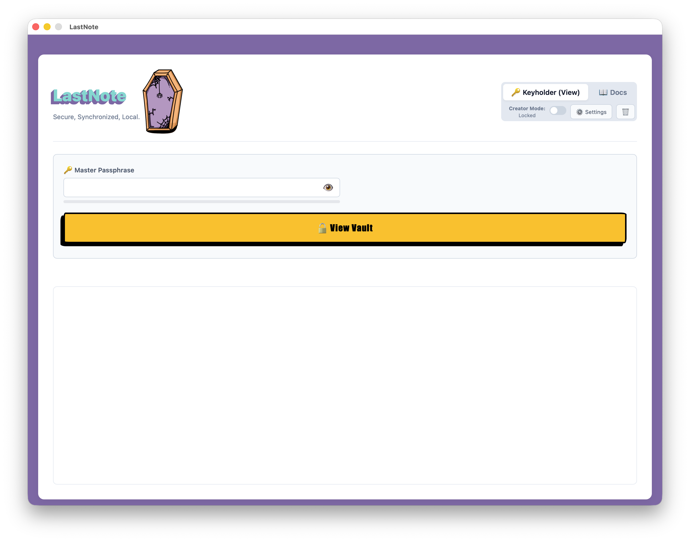
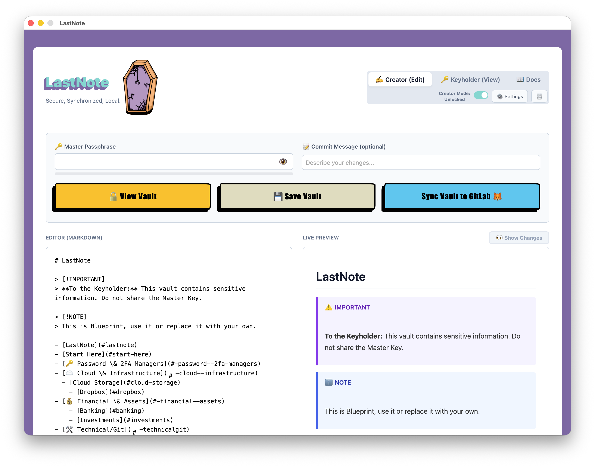
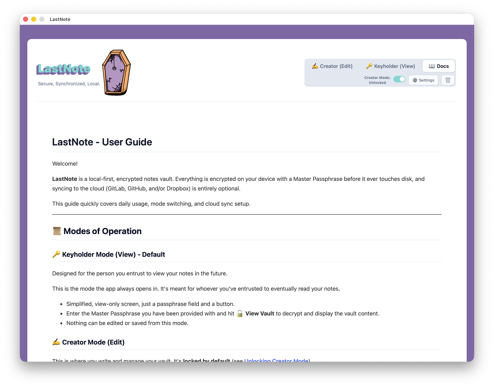
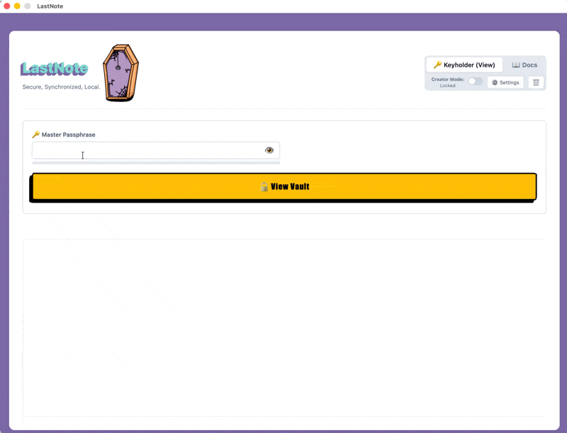

### Keep important information safe and ready for the right moment with LastNote!

Welcome to the first post for 2026!

I've been trying to keep this blog alive and updated but life happens in the meantime and keeps me away from target!

But the time has come for me to finally write about a personal project that I've been working on in parallel and it's called **LastNote**. 

Let me give you some context on why I decided to use such a morbid application name.

### Background 📝

Some years ago, our daughter was born and at that point I decided that I should prepare everything in case I'm not around to show her the world, show her my hobbies, the music and books that I like, photos and places. Would she be able to remember my face and voice?

Also my loved ones should be able to easily track life insurance and work related contracts, investments, broker and bank accounts and all other adult headaches.

So I started directly to gather and document everything in a markdown file, that I was automatically exporting to html, both were pushed in a Gitlab repository for change tracking and saved in a Dropbox shared folder with my wife.

### The Struggle 🤕

Let me tell you knowing my **non-technical** partner, there was 0 chance that she would be able to open the latest information having to go through terminal on her Windows machine, set up git, run commands to pull the latest commit and finally open the exported `html`! 
Especially during the mayhem of the first hours or days that follow the loss of a person.

### The Idea 💡

Then AI and vibe coding took center stage and some months ago it hit me, why not create my own application!

It seemed like a win-win, I would learn something new and my **non-technical** loved ones would have an easy and secure way to access my notes.

### Decision 🤔

Next step was to start gathering the requirements based on what I had in mind and decide on the framework.

Application:
 - should be extremely easy for an end user to view the shared notes.
 - should also provide a way for a power user to create their own notes, secured with a `Master Password` that encrypts/decrypts the vault.
 - should be local, which for me meant an application executable and not a web application as I would have to think about user storage, authentication and security.

After investigating, I decided to develop my first application in [Go](https://go.dev/) and deliver packages via [Wails](https://wails.io/)!

Still didn't have a name for it, but I started anyway!

While developing and continuous bug fixing, I went through a lot of different names but all of them revolved around "will" and this wasn't what this application would be about. 

Then it hit me, this would be my last (a bit morbid) note to the world.

### Under the Hood & Security 🔒

#### Why Wails & Cross-Platform Native Builds?

As this was my first desktop utility, I wanted native performance across Linux, macOS, and Windows without shipping a massive browser bundle. Wails was the perfect choice as it allowed me to use Go for fast file operations and system-level security, while keeping full UI flexibility on the frontend with plain JavaScript, HTML and CSS.

#### Security & Vault Encryption

Since **LastNote** was built to store sensitive information like bank details and insurance policies, security is the top priority. Everything is encrypted locally before touching disk or sync services using `AES-256-GCM` encryption and `Argon2id` password hashing. Because it follows a true zero-knowledge architecture, your `Master Password` never leaves your machine, ensuring complete privacy.

### LastNote {: style="width:40px; vertical-align:middle; display:inline-block; margin-left:2px;"}

I present to you **LastNote**. A Secure, Synchronized and Local application to create, share and view an encrypted vault that keeps your notes.

No subscription, no account, free to use without any restriction.

The application follows the same flow as my initial custom repository but now:
- **Creators** can create, save and sync their vault to Gitlab/Github + Dropbox. When ready, the `Master Password` and the `encrypted files` should be shared (USB, zip, email, Dropbox folder share etc).
- **Keyholders** can view the vault as long as they have access to the `encrypted files`, the **LastNote** executable and the `Master Password` shared by the creator. 
Executables can be downloaded from the official [Releases page](https://gitlab.com/paparoup/lastnote/-/releases).

For supported operating systems, downloads and a short description of the application, check the official [LastNote Site](https://zoisroupas.dev/lastnote/)

For more details on installation, usage, licensing, and instructions, refer to the official [LastNote Repository](https://gitlab.com/paparoup/lastnote)

#### Screenshots 📸

<strong>Keyholder View</strong>

<strong>Creator View</strong>

<strong>Docs View</strong>

<strong>Keyholder Vault View</strong>

A full demo of the application can be found below.
<iframe width="760" height="515" src="https://www.youtube.com/embed/ewhvwjyiotU" title="YouTube video player" frameborder="0" allow="accelerometer; autoplay; clipboard-write; encrypted-media; gyroscope; picture-in-picture" allowfullscreen></iframe>

## Final Words 💡

This application was created purely to fulfill my own needs.

There are probably plenty of feature packed tools out there with kill switches and advanced sharing options, but I wanted to build something tailored to my own taste, design style, and specific workflow. 
If it turns out to be useful to others along the way, that’s even better!

If you find **LastNote** useful, feel free to leave a star on GitLab or open an issue for feature requests!

Thanks for reading, until the next post and as Dr Wallace Breen says in Half-Life 2..
Be wise. Be safe. Be aware!